[← All projects](index.html)

<h2 style="color:#4682B4;"> IGEN 330 Capstone Project </h2>

#### Project Description
- Designing an AI Mirror which recommends the user an outfit based on weather and occasion

 

#### Camera Safety Module
- Designed and modelled the parts and assembly for the cover of the camera
- Made to be user friendly with a sliding cover for privacy

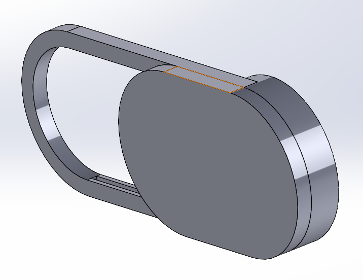           
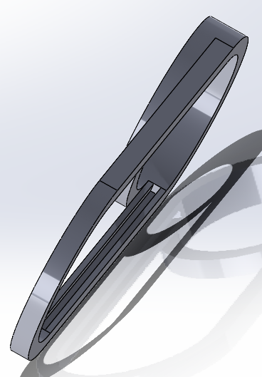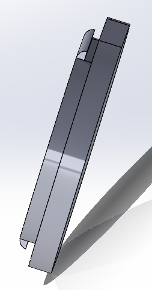
<video width="300" controls><source src="assets/IGEN330_Capstone/cameracover_prototype.mp4" type="video/mp4"></video>               

 

#### Microcontroller Housing
- Designed and modelled the parts for the housing of the Jetson microcontroller
- Made-to-fit with access to cable connection

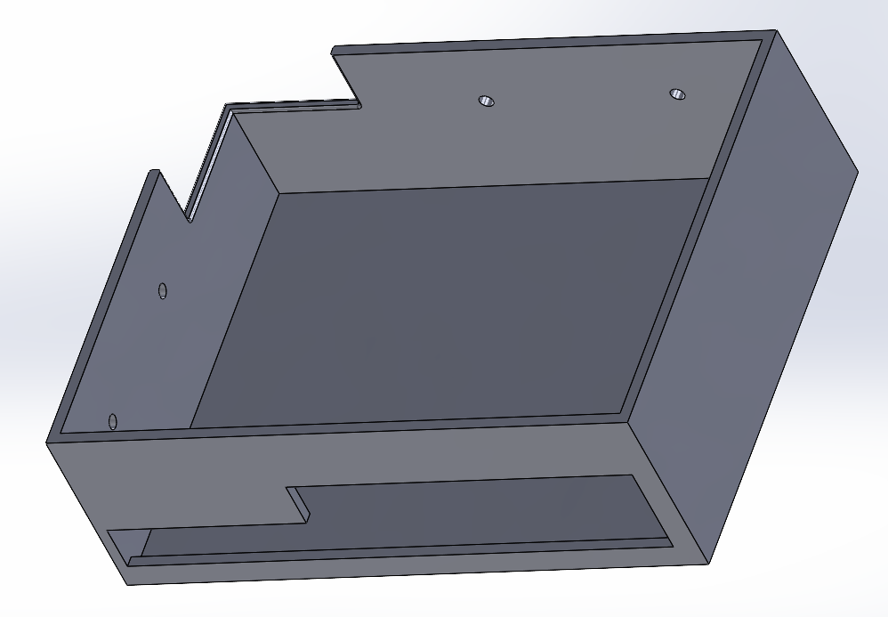                          

 

#### Mirror Frame
- Designed and modelled the parts and assembly for the mirror frame
- Suited for woodworking; composed of four layers (front panel, middle panel, supports, back panel) + stand
- Front and middle panel provide an extruded edge for the mirror to sit on top
- Stand designed for internal wiring and allocated storage 

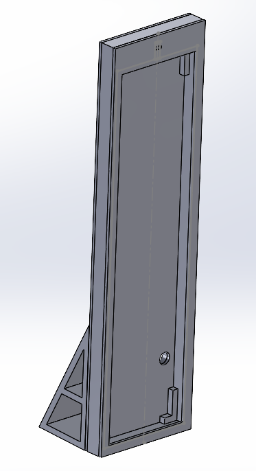      
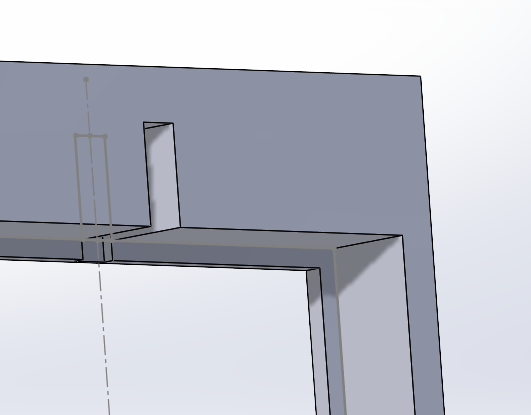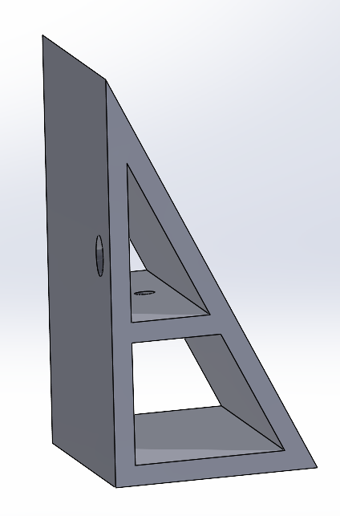 

 

#### Manufacturing
- Woodworking sessions to build main frame, back support and stand
- Utilized miter saw, band saw, drill press, pocket hole, belt sander, palm sander, chisel, drill

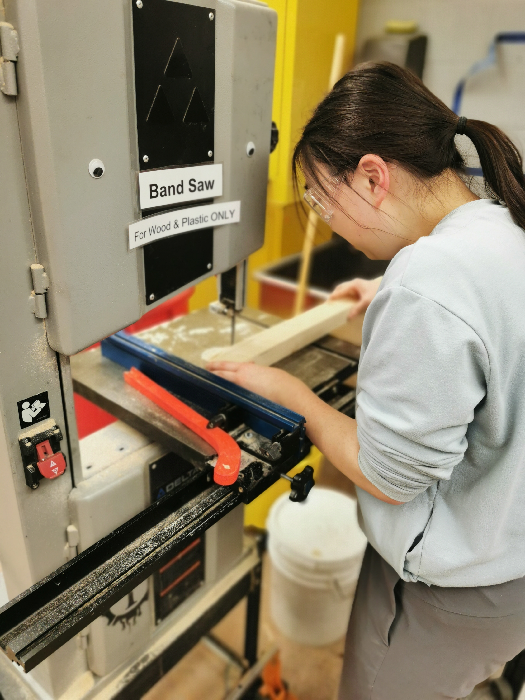     
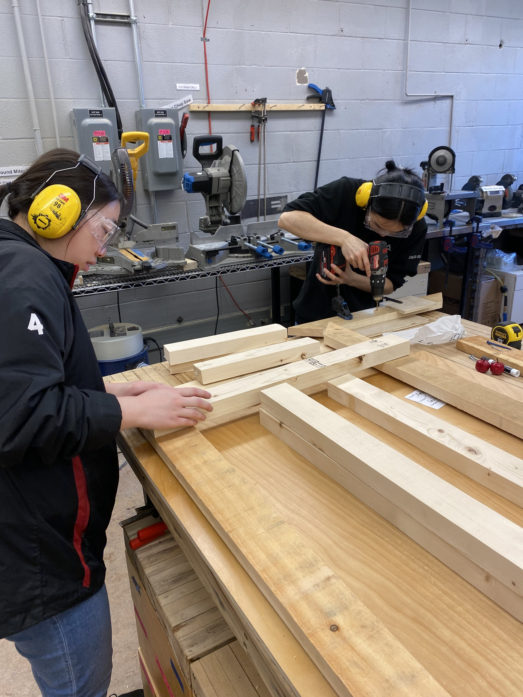 
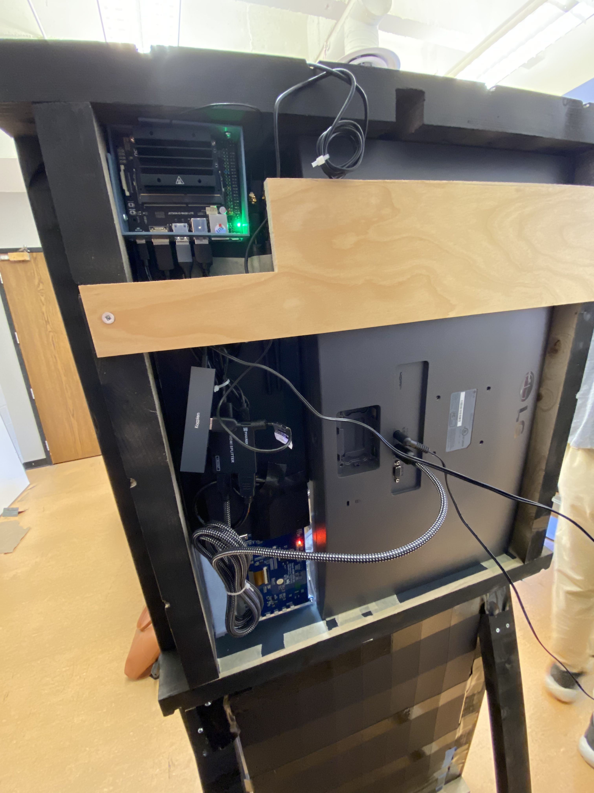 

 

#### Design and Innovation Day (DAID)
- Showcased capstone projects to the general public
- Explanation and description of design process and key iterations
- Demonstration of product

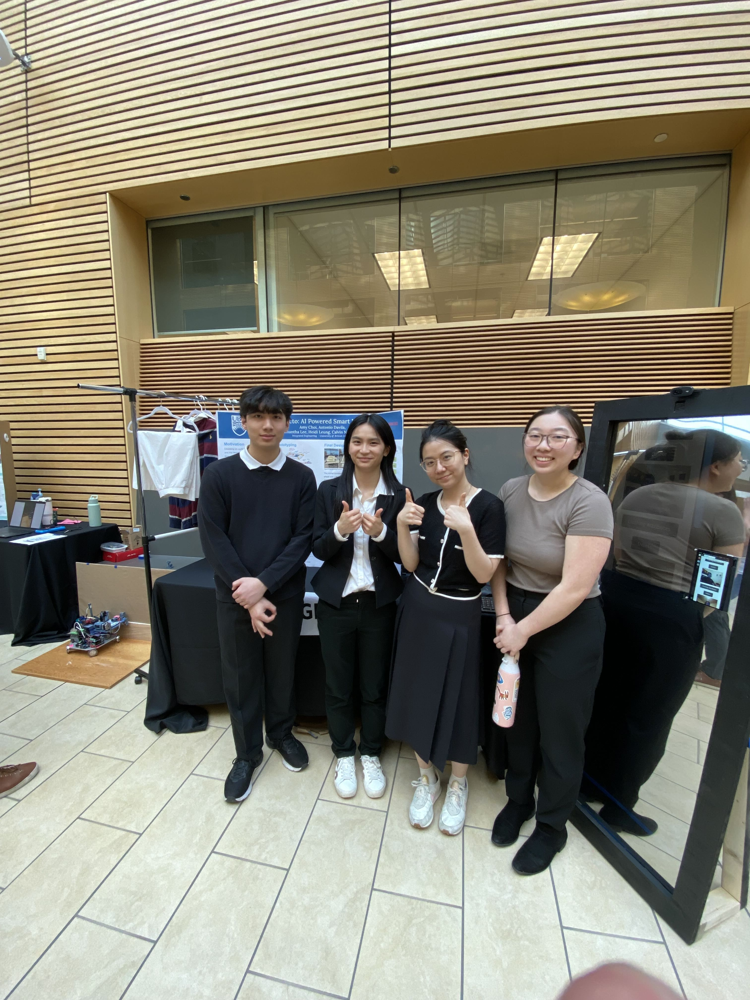 

 

[← Previous: UBC Sailbot](sailbot.html) | [Next: Self-Heating Ski Goggles →](ski-goggles.html)
