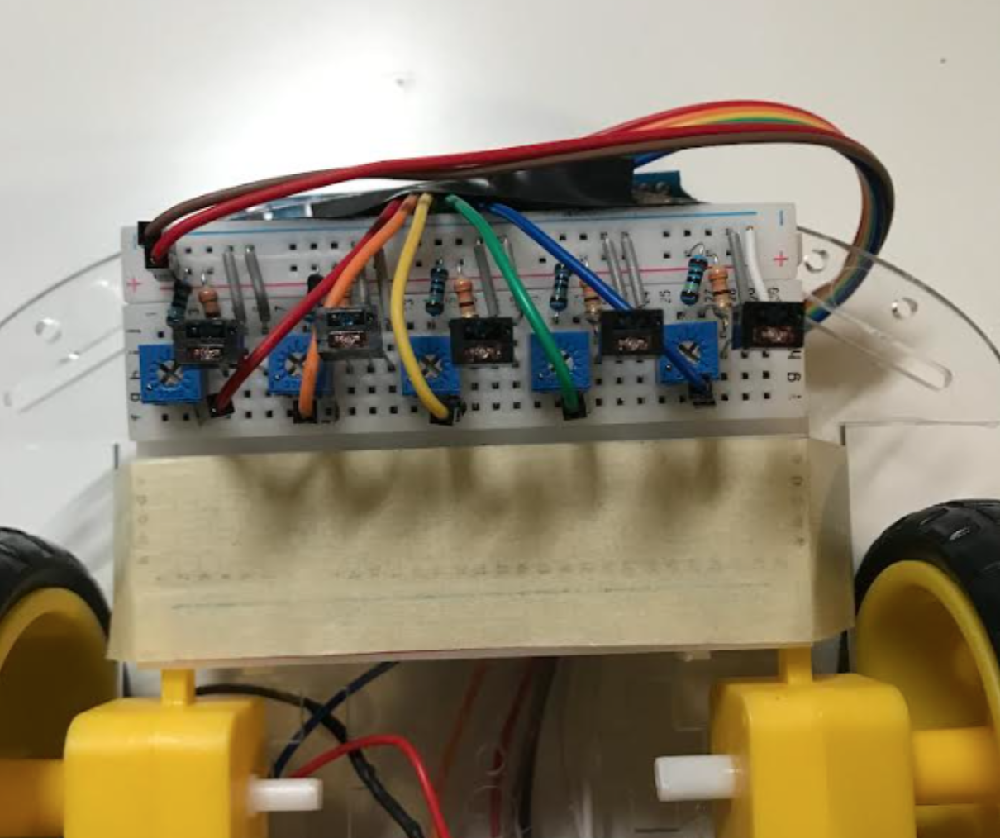
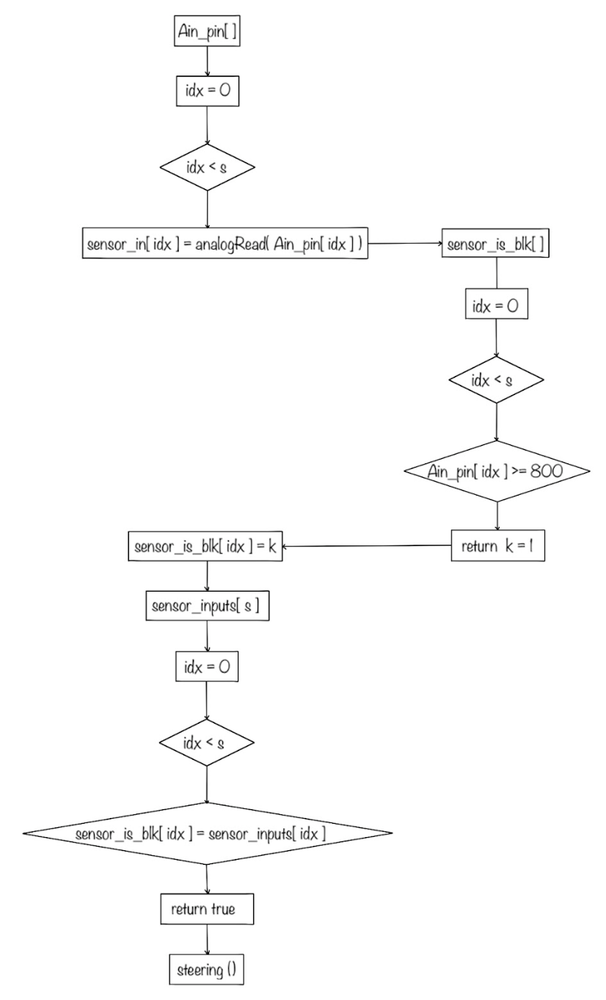

<h2 style="color:#4682B4;"> IGEN 230 Line Following Robot Project </h2>

#### Project Description
- Designed and constructed the mechanical structure necessary for a line-following robot
- Constructed the electrical circuit connecting power, photo-transistors, H-bridge and motors
- Implemented H-Bridge Board 
  - H-Bridge for direction control &rarr; running motors forwards and backwards
  - PWM for speed control &rarr; phototransistor is on when it sees white (detects more light)
  - Developed personal code to complete tracks including turns up to 360 degrees, comprehension of intersections and missing lines

<video width="480" controls><source src="assets/IGEN230_LineFollowingRobot/track1.mp4" type="video/mp4"></video>                                
<video width="225" controls><source src="assets/IGEN230_LineFollowingRobot/track2_forwards.mp4" type="video/mp4"></video> <video width="225" controls><source src="assets/IGEN230_LineFollowingRobot/track2_backwards.mp4" type="video/mp4"></video>                    

[Arduino Code - Click Here!](assets/IGEN230_LineFollowingRobot/code_track34.txt)

 
