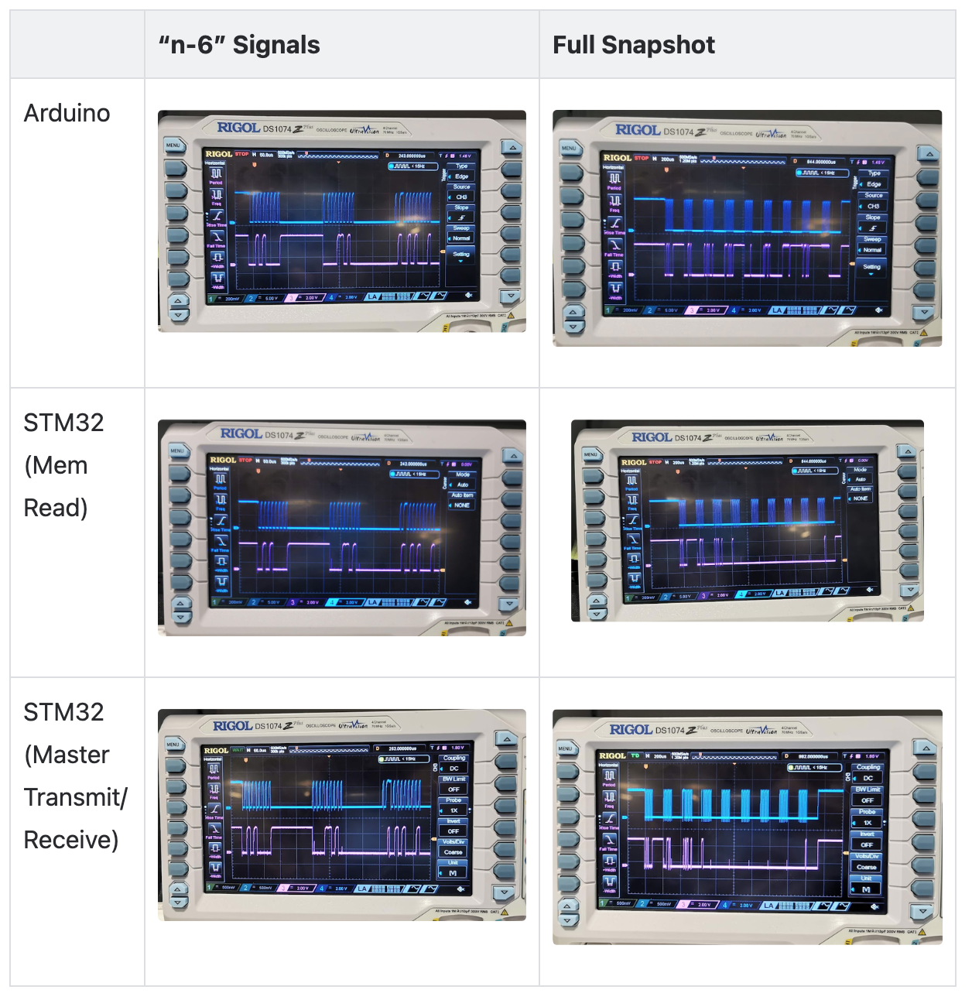
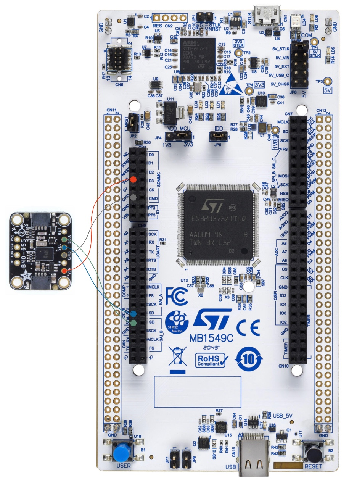
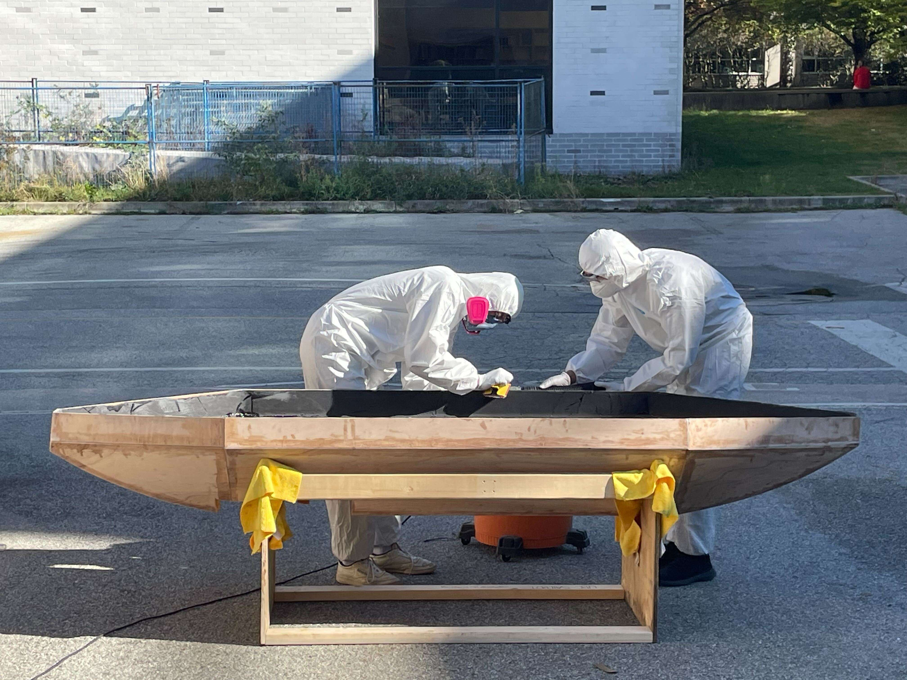

[← All projects](README.html)

<h2 style="color:#4682B4;"> UBC Sailbot - Electrical Team </h2>

Electrical Team Member at [UBC Sailbot](https://www.ubcsailbot.org/) (Sept 2024 - Present)

#### Navigation - IMU Sensor Development
- responsible for displaying boat heading at all times for navigation
- programmed and tested code through I2C peripheral using an oscilloscope, Arduino Uno Rev3 and STM32 U575
- programmed code for proper calibration and exception handling 
- developed and executed testing procedures for IMU limitations in simulated environments

 <video width="225" controls>  <source src="assets/UBCSailbot_IMU/imu_eulerdata_printing.mp4" type="video/mp4"> </video>

 

#### Manufacturing Polaris (Our New Sailboat!)
- While I am on the Electrical team, there are many opportunities to integrate with other teams and work on other project elements such as manufacturing
- Helped with carbon fibre fairing layup
  - Sized and oriented carbon fibre sheets
  - Prepared and applied structural and non-structural epoxy

 <video width="270" controls> <source src="assets/UBCSailbot_PLRS_Layup/carbon_fibre_timelapse.mp4" type="video/mp4"> </video>

 

[← All projects](README.html) | [Next: AI Smart Mirror →](ai-mirror.html)
