<h2 style="color:#4682B4;"> IGEN 230 Capstone Project </h2>

#### Project Description
- Designed a self heating and waterproof ski goggle attachment using ITO, polycarbonate, and 3D printed resin

 

#### Electronic Design
- Designed a closed-loop thermal control circuit using an LM35 temperature sensor, an LM393 comparator and a MOSFET to switch power to the ITO heating film based on measured ambient temperature
- Added a potentiometer-based reference voltage so the heating threshold can be adjusted, and an MCP1700 regulator to provide a stable 3.3 V reference from a 9 V battery
- Built and tested circuit on a breadboard

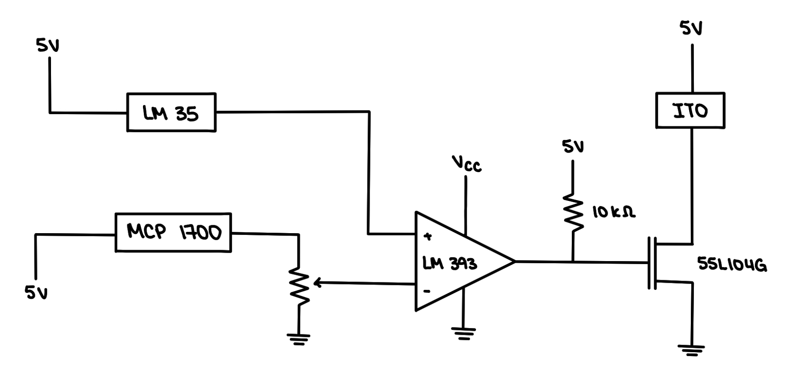         
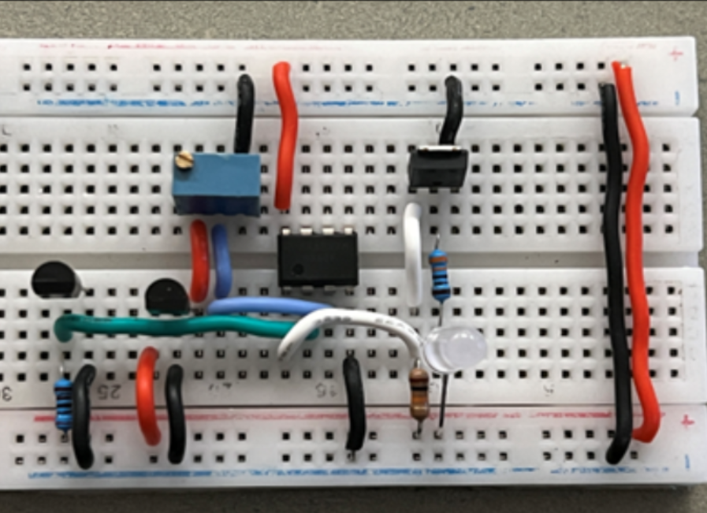

 

#### Heat Element Testing
- Developed testing method 
- Led standardized testing to determine the best ratio of material to be used for the heating element of the goggles

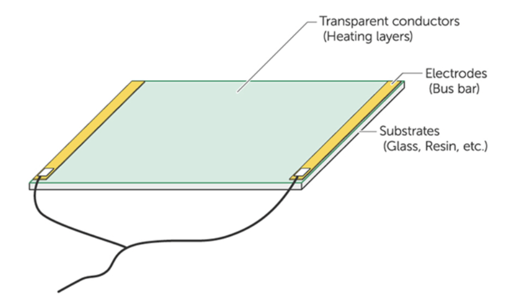         
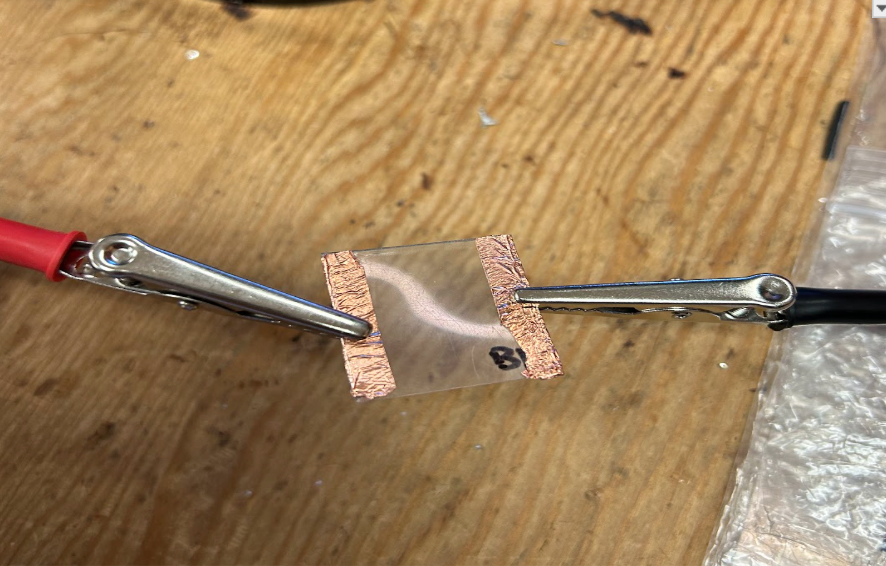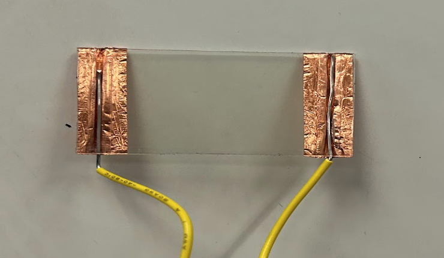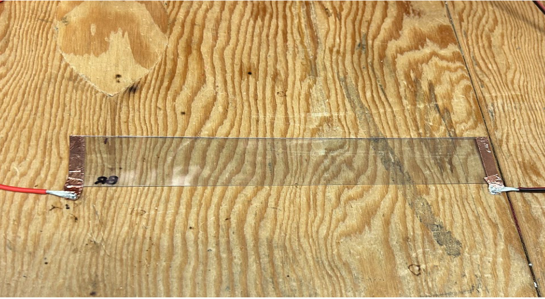

 

#### Environment Temperature Testing
- Developed testing method 
- Led standardized testing to determine the effect of starting temperature on the heating element of the goggles

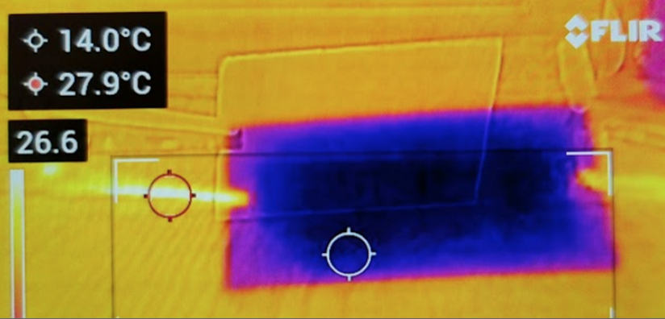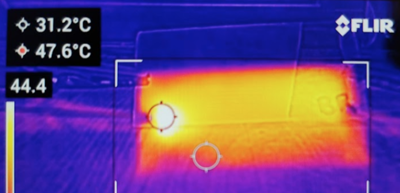

 

#### Waterproof Material Testing
- Developed testing method 
- Led standardized testing to determine the effect of water on the heating element of the goggles

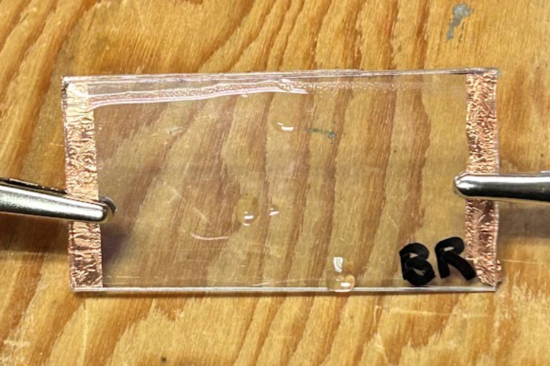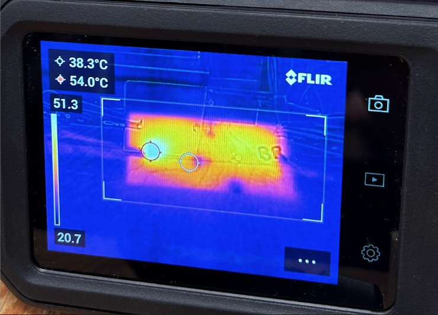

 

#### Design and Innovation Day (DAID)
- Showcased capstone projects to the general public
- Explanation and description of design process and key iterations
- Demonstration of product

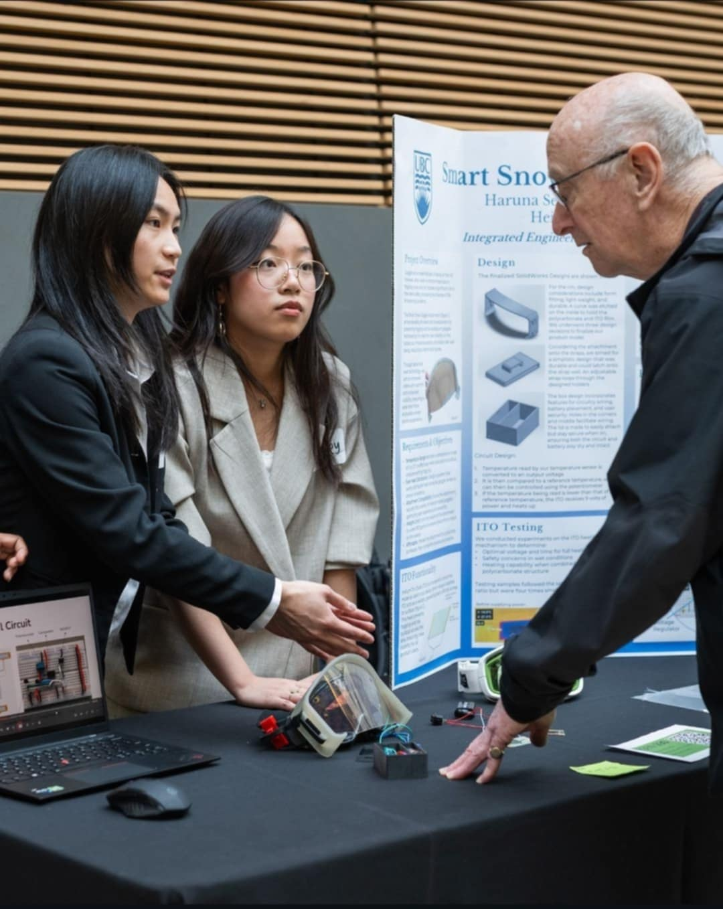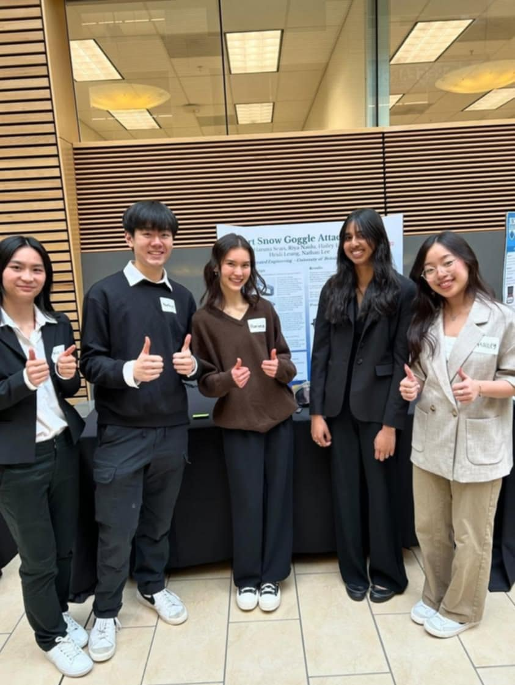           
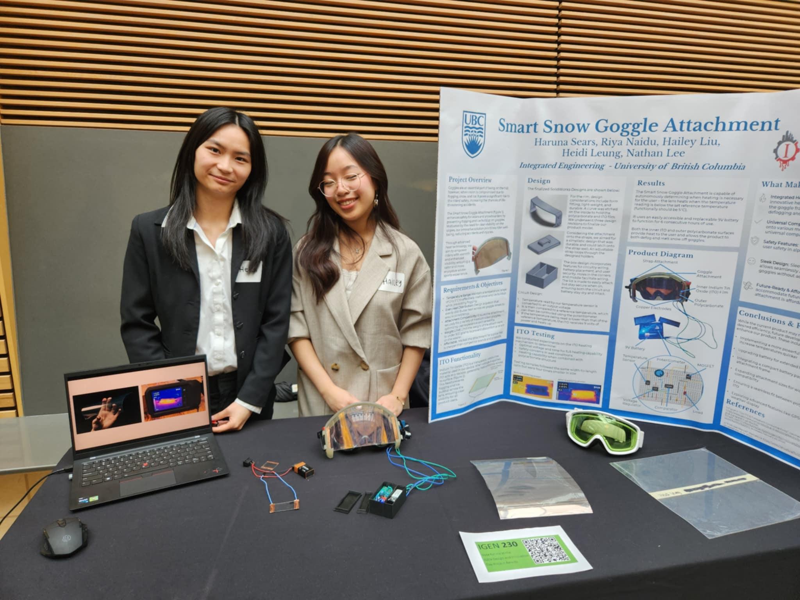

 
