[← All projects](./)

<h2 style="color:#4682B4;"> IGEN 230 Capstone Project </h2>

#### Project Description
- Designed self heating and waterproof ski goggles using ITO, polycarbonate, and 3D printed resin

 

#### Heat Element Testing
- Developed testing method 
- Led standardized testing to determine the best ratio of material to be used for the heating element of the goggles

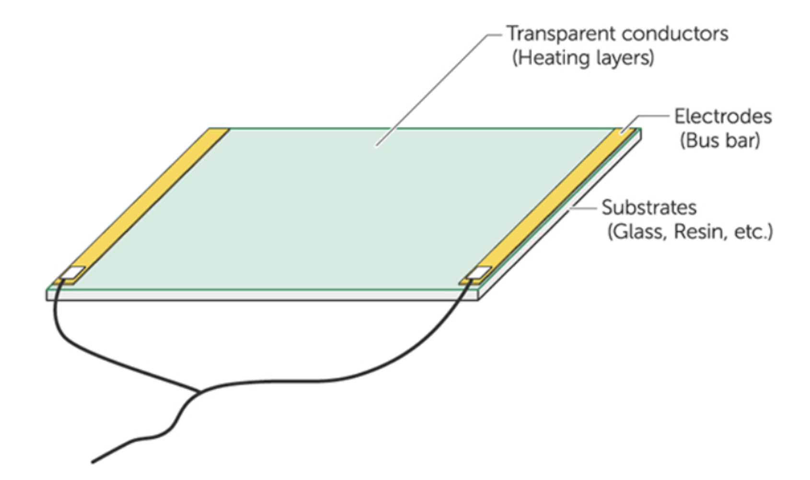         
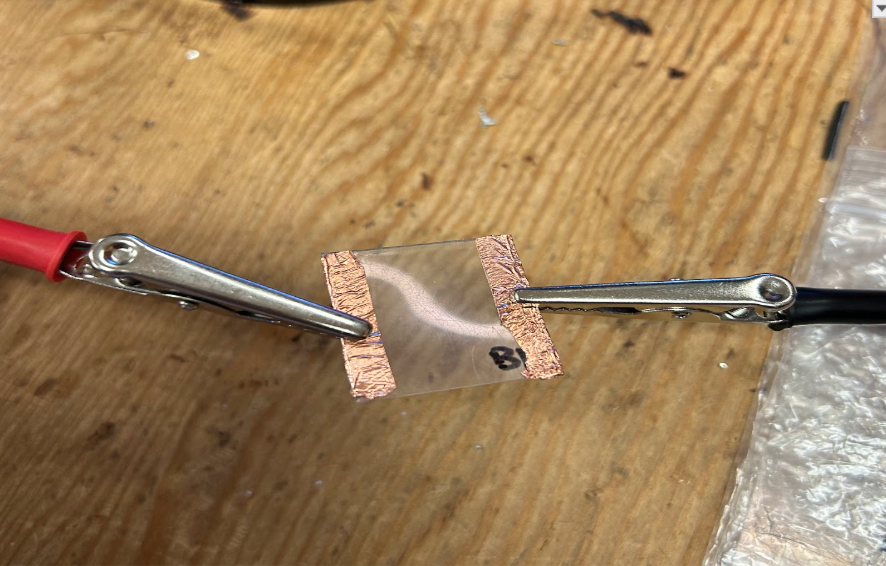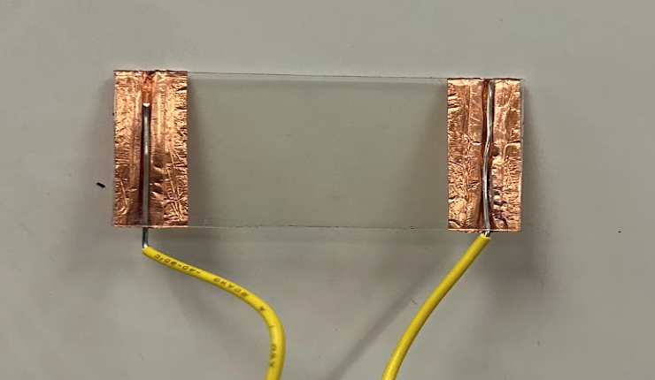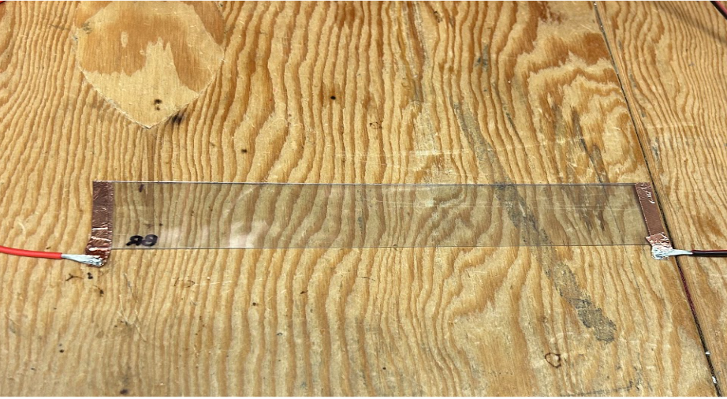

 

#### Environment Temperature Testing
- Developed testing method 
- Led standardized testing to determine the effect of starting temperature on the heating element of the goggles

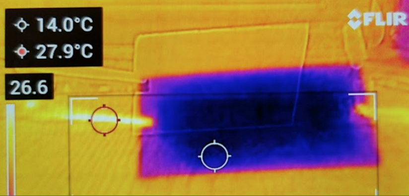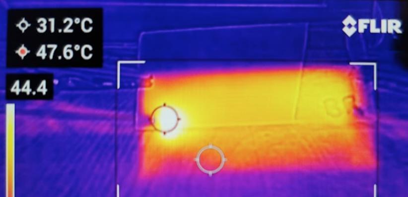

 

#### Waterproof Material Testing
- Developed testing method 
- Led standardized testing to determine the effect of water on the heating element of the goggles

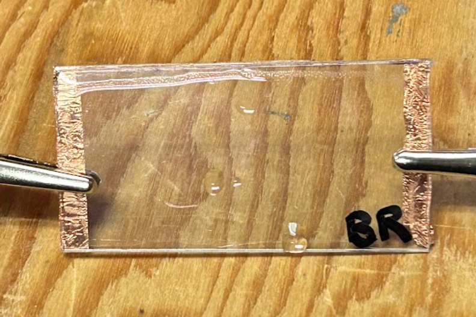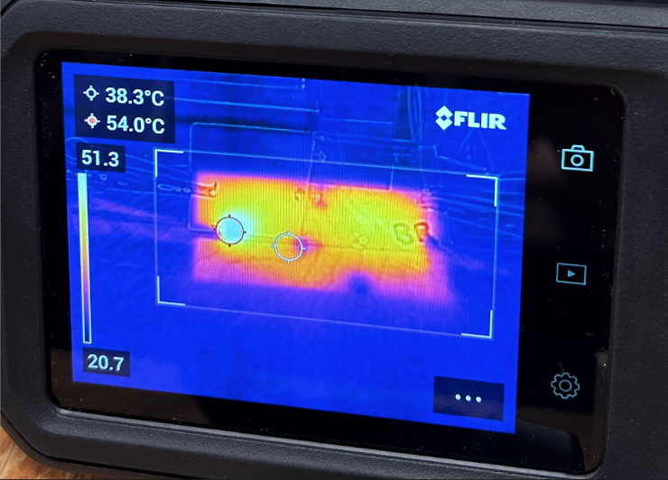

 

#### Design and Innovation Day (DAID)
- Showcased capstone projects to the general public
- Explanation and description of design process and key iterations
- Demonstration of product

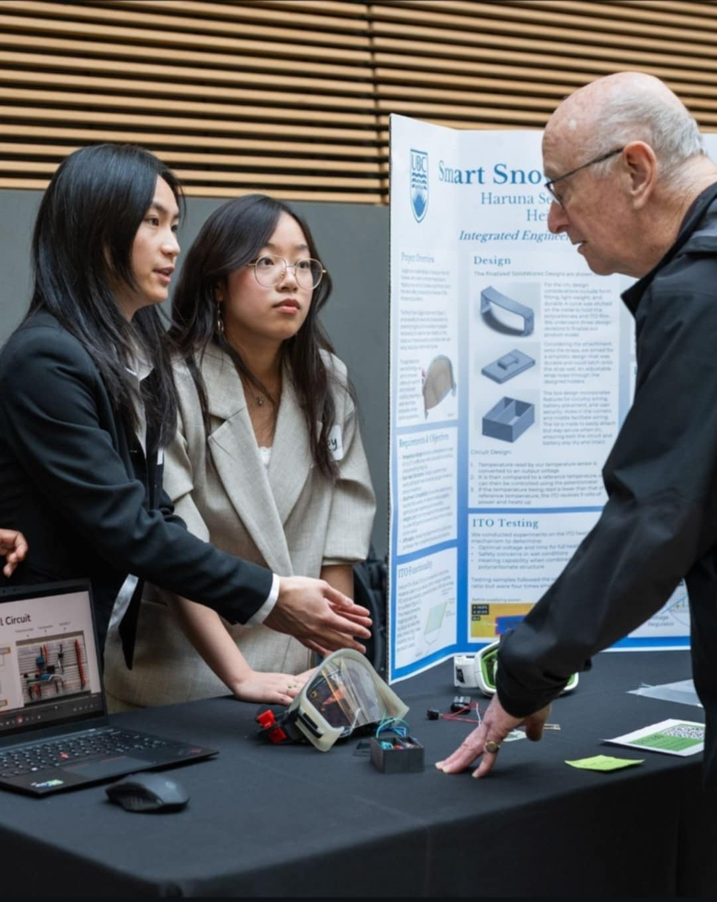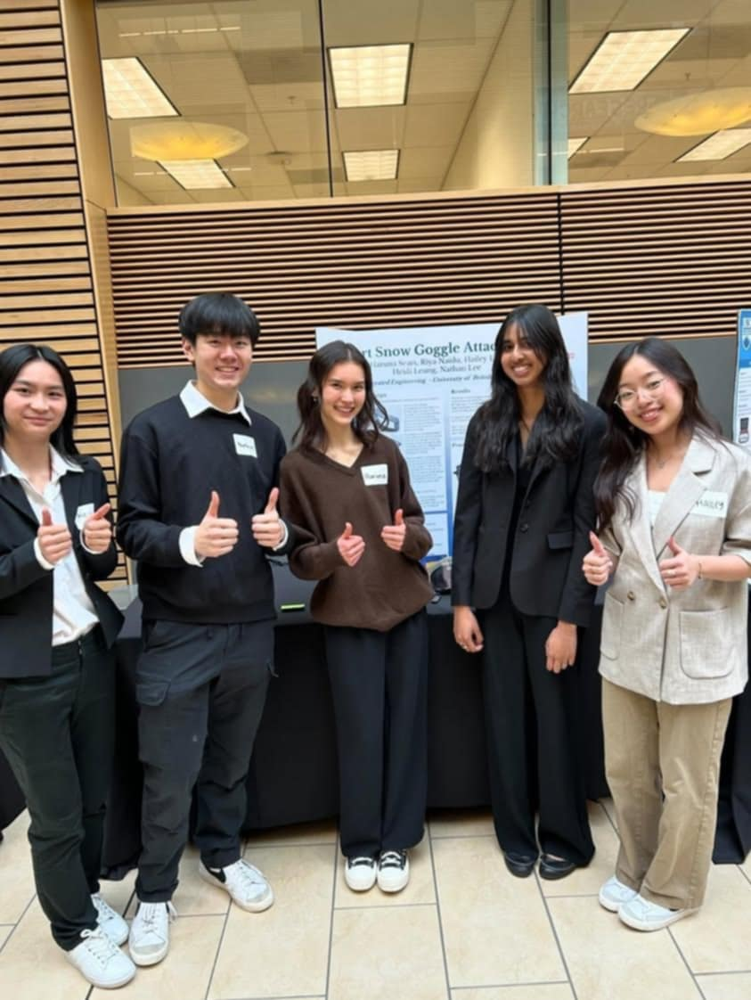           
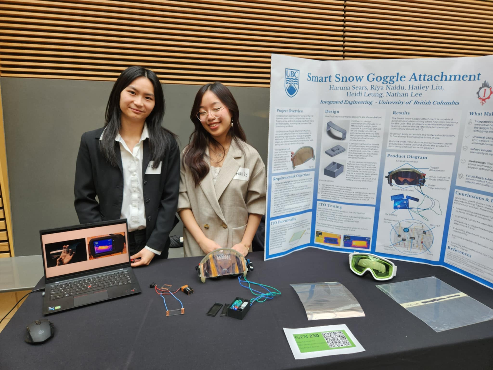

 

[← Previous: AI Smart Mirror](ai-mirror) | [Next: Line-Following Robot →](line-robot)
